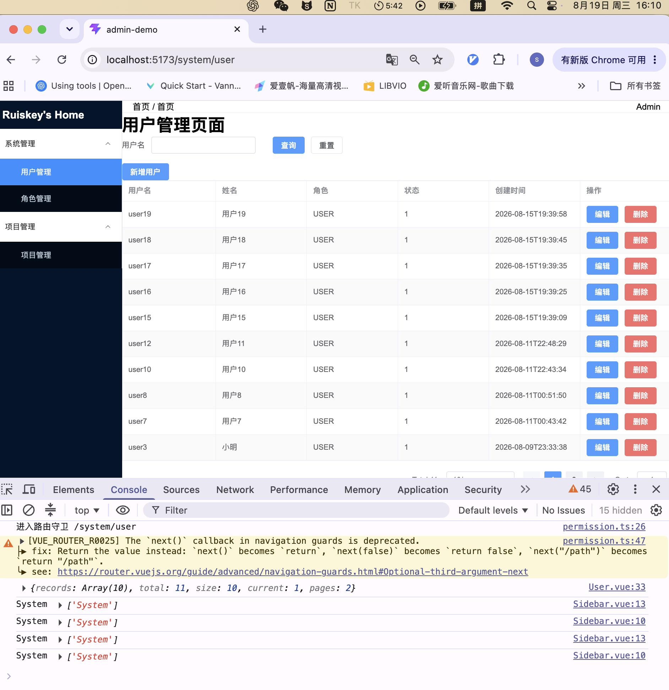

# 每日变化

## 2026-08-09

完成：
- 用户的操作列功能按钮，完成删除按钮功能

问题：

解决：

下一步：
完成编辑按钮


## 2026-08-11
完成：
- 完成用户列表的编辑功能
- 将userDialog拆出User, 添加主子组件通信写法

问题：
什么是emit
const dialogRef = ref()
// 暴露给父组件
defineExpose({
    open
})
解决：

下一步：
用户管理页面的搜索功能

## 2026-08-19
#### 过程：
- 实现多层级路由
  - 1 创建中间路由组件
  - 2 修改routes的generateRoutes
  - 3 路由修改由/user改为usr
  - 4 增加组件不存在校验
  - 5 替换elementUI中的el-menu
  - 6 修改style.css中item项的样式

#### 碰到的问题记录：
1 v-slot的缩写
```html
    <template #title>
        <span>{{ menu.title }}</span>
    </template>
```
2 sidebar的element-ui写法
```html
    <el-menu
            default-active="2"
            class="sidebar-menu"
            @select="handleSelect"
            @open="handleOpen"
            @close="handleClose"
        >
            <el-sub-menu
                v-for="menu in menuStore.menuList" :key="menu.objectId" :index="menu.name">
                <!-- 具名插槽 -->
                <template v-slot:title>
                    <span>{{ menu.title }}</span>
                </template>
                <!-- 二级菜单 -->
                 <el-menu-item v-for="child in menu.children || []" :key="child.objectId" :index="child.name">
                    {{ child.title }}
                 </el-menu-item>
            </el-sub-menu>
        </el-menu>
```
#### 完成：
页面效果：


#### 待办
1 路由是如何拼接的
2 完善角色管理，项目管理这些细节